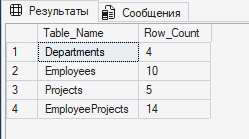

# SQL notes
> Учебная БД: PracticeDB. Скрипт создания — `init.sql`.
> Все запросы выполнялись в SSMS.


## Task 01 — Создание базы и таблиц
### SQL

### Запрос
```sql
USE PracticeDB;
GO
SELECT TABLE_NAME 
FROM INFORMATION_SCHEMA.TABLES 
WHERE TABLE_TYPE = 'BASE TABLE';
```
### Результат


### Вывод

не чего сложного не было с этим уже приходилось работать

## Task 02 — INSERT: заполнение данными
### SQL

### Запрос
```sql
SELECT 'Departments' AS Table_Name, COUNT(*) AS Row_Count FROM Departments
UNION ALL
SELECT 'Employees', COUNT(*) FROM Employees
UNION ALL
SELECT 'Projects', COUNT(*) FROM Projects
UNION ALL
SELECT 'EmployeeProjects', COUNT(*) FROM EmployeeProjects;
```
### Результат



### Вывод

не чего сложного не было с этим уже приходилось работать