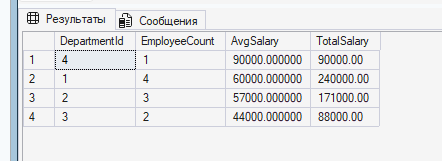
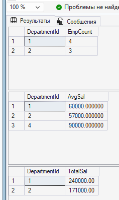
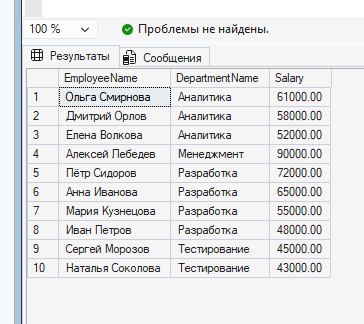
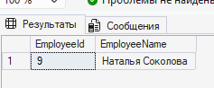
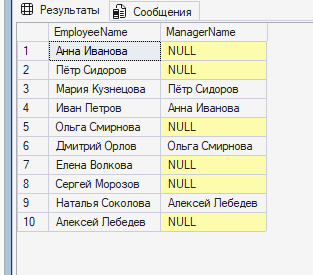
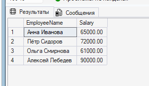

# SQL notes
> Учебная БД: PracticeDB. Скрипт создания — `init.sql`.
> Все запросы выполнялись в SSMS.


## Task 01 — Создание базы и таблиц
### SQL

### Запрос
```sql
USE PracticeDB;
GO
SELECT TABLE_NAME 
FROM INFORMATION_SCHEMA.TABLES 
WHERE TABLE_TYPE = 'BASE TABLE';
```
### Результат


### Вывод

не чего сложного не было с этим уже приходилось работать

## Task 02 — INSERT: заполнение данными
### SQL

### Запрос
```sql
SELECT 'Departments' AS Table_Name, COUNT(*) AS Row_Count FROM Departments
UNION ALL
SELECT 'Employees', COUNT(*) FROM Employees
UNION ALL
SELECT 'Projects', COUNT(*) FROM Projects
UNION ALL
SELECT 'EmployeeProjects', COUNT(*) FROM EmployeeProjects;
```
### Результат


### Вывод

не чего сложного не было с этим уже приходилось работать

## Task 03 — SELECT + WHERE: базовые выборки
### SQL

### Запрос
```sql
-- 1. Сотрудники с зарплатой > 50000
SELECT * FROM Employees WHERE Salary > 50000;

-- 2. Сотрудники, нанятые в 2023 году
SELECT * FROM Employees WHERE YEAR(HireDate) = 2023;

-- 3. Сотрудники, чьё имя начинается на «А»
SELECT * FROM Employees WHERE EmployeeName LIKE N'А%';

-- 4. Сотрудники из отдела DepartmentId = 2
SELECT * FROM Employees WHERE DepartmentId = 2;

-- 5. Сотрудники с зарплатой 40000–60000
SELECT * FROM Employees WHERE Salary BETWEEN 40000 AND 60000;
```
### Результат


### Вывод

Всё понятно


## Task 04 — ORDER BY + TOP: сортировка и лимит
### SQL

### Запрос
```sql
-- Топ-3 по зарплате (убывание)
SELECT TOP 3 * FROM Employees ORDER BY Salary DESC;

-- Топ-5 самых давних сотрудников (возрастание HireDate)
SELECT TOP 5 * FROM Employees ORDER BY HireDate ASC;

-- Сортировка по отделу (возр.), затем по зарплате (убыв.)
SELECT * FROM Employees 
ORDER BY DepartmentId ASC, Salary DESC;
```
### Результат


### Вывод
Оператор `TOP` удобно использовать для быстрого анализа лидеров или "старичков" компании. Важно помнить, что при сортировке по нескольким полям порядок указания столбцов в `ORDER BY` критически влияет на результат.
## Task 05 — Агрегация: COUNT, SUM, AVG, MIN, MAX
### SQL

### Запрос
```sql
SELECT 
    COUNT(*) AS TotalEmployees,
    SUM(Salary) AS TotalSalary,
    ROUND(AVG(Salary), 2) AS AvgSalary,
    MIN(Salary) AS MinSalary,
    MAX(Salary) AS MaxSalary,
    COUNT(CASE WHEN Salary > 50000 THEN 1 END) AS HighSalaryCount
FROM Employees;
```
### Результат


### Вывод
Агрегатные функции позволяют получить сводную статистику одним запросом. Функция `ROUND` необходима для корректного отображения средней зарплаты, так как `AVG` часто возвращает длинную дробную часть. Условный `COUNT` через `CASE` полезен для подсчета специфических групп без дополнительных фильтров.

## Task 06 — GROUP BY: статистика по отделам
### SQL

### Запрос
```sql
SELECT 
    DepartmentId,
    COUNT(*) AS EmployeeCount,
    ROUND(AVG(Salary), 2) AS AvgSalary,
    SUM(Salary) AS TotalSalary
FROM Employees
GROUP BY DepartmentId
ORDER BY AvgSalary DESC;
```
### Результат



### Вывод
`GROUP BY` преобразует детальные данные в сводные строки. Главное правило: все столбцы в `SELECT`, не являющиеся агрегатными функциями, должны быть перечислены в `GROUP BY`. Иначе сервер не поймет, какое значение выводить для группы.

## Task 07 — GROUP BY + HAVING: фильтрация групп
### SQL

### Запрос
```sql
-- Отделы с > 2 сотрудниками
SELECT DepartmentId, COUNT(*) AS EmpCount 
FROM Employees 
GROUP BY DepartmentId 
HAVING COUNT(*) > 2;

-- Отделы со средней зарплатой > 55000
SELECT DepartmentId, ROUND(AVG(Salary), 2) AS AvgSal 
FROM Employees 
GROUP BY DepartmentId 
HAVING AVG(Salary) > 55000;

-- Отделы с суммарной зарплатой > 150000
SELECT DepartmentId, SUM(Salary) AS TotalSal 
FROM Employees 
GROUP BY DepartmentId 
HAVING SUM(Salary) > 150000;
```
### Результат



### Вывод
Ключевое отличие `HAVING` от `WHERE`: `WHERE` фильтрует отдельные строки *до* группировки, а `HAVING` фильтрует уже сформированные группы *после* агрегации. Попытка использовать `WHERE` с агрегатной функцией вызовет ошибку синтаксиса.

## Task 08 — INNER JOIN: сотрудники и отделы
### SQL

### Запрос
```sql
SELECT 
    e.EmployeeName,
    d.DepartmentName,
    e.Salary
FROM Employees e
INNER JOIN Departments d ON e.DepartmentId = d.DepartmentId
ORDER BY d.DepartmentName ASC, e.Salary DESC;
```
### Результат



### Вывод
`INNER JOIN` возвращает только те строки, для которых нашлось совпадение в обеих таблицах. Это базовый способ нормализации данных: мы храним ID отдела в таблице сотрудников, но для отчета подставляем текстовое название из справочника отделов.


## Task 09 — LEFT JOIN: сотрудники без проектов
### SQL

### Запрос
```sql
SELECT 
    e.EmployeeId,
    e.EmployeeName
FROM Employees e
LEFT JOIN EmployeeProjects ep ON e.EmployeeId = ep.EmployeeId
WHERE ep.EmployeeId IS NULL;
```
### Результат



### Вывод
`LEFT JOIN` сохраняет все строки из левой таблицы (`Employees`), даже если справа нет совпадений. В таких случаях столбцы правой таблицы заполняются `NULL`. Фильтрация по `IS NULL` — стандартный паттерн поиска "несуществующих связей" (анти-соединение).


## Task 10 — Множественный JOIN: полная картина
### SQL

### Запрос
```sql
SELECT 
    e.EmployeeName,
    d.DepartmentName,
    p.ProjectName,
    ep.Hours
FROM Employees e
INNER JOIN Departments d ON e.DepartmentId = d.DepartmentId
INNER JOIN EmployeeProjects ep ON e.EmployeeId = ep.EmployeeId
INNER JOIN Projects p ON ep.ProjectId = p.ProjectId
ORDER BY d.DepartmentName, e.EmployeeName, p.ProjectName;
```
### Результат


### Вывод
При соединении 4 таблиц важно выстраивать цепочку связей логично: Сотрудники → Отделы (через DeptId), Сотрудники → Назначения (через EmpId), Назначения → Проекты (через ProjId). Псевдонимы таблиц (`e`, `d`, `p`, `ep`) делают запрос читаемым и сокращают код.

## Task 11 — Self-join: иерархия руководителей
### SQL

### Запрос
```sql
SELECT 
    e.EmployeeName,
    m.EmployeeName AS ManagerName
FROM Employees e
LEFT JOIN Employees m ON e.ManagerId = m.EmployeeId;
```
### Результат



### Вывод
Self-join позволяет соединить таблицу саму с собой для работы с иерархическими данными. Использование `LEFT JOIN` критически важно: оно сохраняет сотрудников, у которых нет руководителя (`ManagerId IS NULL`), показывая для них `NULL` в столбце `ManagerName`. При `INNER JOIN` такие сотрудники пропали бы из выборки.

## Task 12 — Подзапросы в WHERE
### SQL

### Запрос
```sql
-- Сотрудники с зарплатой выше средней по компании
SELECT EmployeeName, Salary
FROM Employees
WHERE Salary > (SELECT AVG(Salary) FROM Employees);

-- Сотрудники с максимальной зарплатой
SELECT EmployeeName, Salary
FROM Employees
WHERE Salary = (SELECT MAX(Salary) FROM Employees);
```
### Результат



### Вывод
Скалярный подзапрос в `WHERE` должен возвращать ровно одно значение. Если подзапрос вернет несколько строк, выполнение завершится ошибкой. Для сравнения с набором значений нужно использовать операторы `IN`, `ANY` или `ALL`. В данном случае `AVG()` и `MAX()` гарантированно дают один результат.
