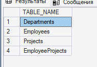
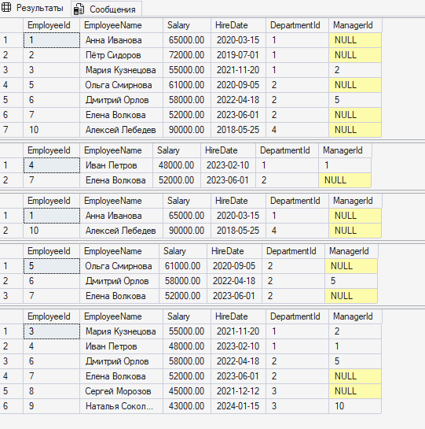
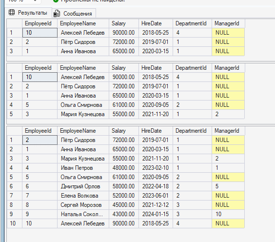
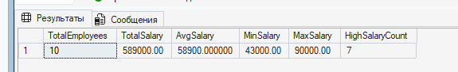

# SQL notes
> Учебная БД: PracticeDB. Скрипт создания — `init.sql`.
> Все запросы выполнялись в SSMS.


## Task 01 — Создание базы и таблиц
### SQL

### Запрос
```sql
USE PracticeDB;
GO
SELECT TABLE_NAME 
FROM INFORMATION_SCHEMA.TABLES 
WHERE TABLE_TYPE = 'BASE TABLE';
```
### Результат



### Вывод

не чего сложного не было с этим уже приходилось работать

## Task 02 — INSERT: заполнение данными
### SQL

### Запрос
```sql
SELECT 'Departments' AS Table_Name, COUNT(*) AS Row_Count FROM Departments
UNION ALL
SELECT 'Employees', COUNT(*) FROM Employees
UNION ALL
SELECT 'Projects', COUNT(*) FROM Projects
UNION ALL
SELECT 'EmployeeProjects', COUNT(*) FROM EmployeeProjects;
```
### Результат


### Вывод

не чего сложного не было с этим уже приходилось работать

## Task 03 — SELECT + WHERE: базовые выборки
### SQL

### Запрос
```sql
-- 1. Сотрудники с зарплатой > 50000
SELECT * FROM Employees WHERE Salary > 50000;

-- 2. Сотрудники, нанятые в 2023 году
SELECT * FROM Employees WHERE YEAR(HireDate) = 2023;

-- 3. Сотрудники, чьё имя начинается на «А»
SELECT * FROM Employees WHERE EmployeeName LIKE N'А%';

-- 4. Сотрудники из отдела DepartmentId = 2
SELECT * FROM Employees WHERE DepartmentId = 2;

-- 5. Сотрудники с зарплатой 40000–60000
SELECT * FROM Employees WHERE Salary BETWEEN 40000 AND 60000;
```
### Результат



### Вывод

Всё понятно


## Task 04 — ORDER BY + TOP: сортировка и лимит
### SQL

### Запрос
```sql
-- Топ-3 по зарплате (убывание)
SELECT TOP 3 * FROM Employees ORDER BY Salary DESC;

-- Топ-5 самых давних сотрудников (возрастание HireDate)
SELECT TOP 5 * FROM Employees ORDER BY HireDate ASC;

-- Сортировка по отделу (возр.), затем по зарплате (убыв.)
SELECT * FROM Employees 
ORDER BY DepartmentId ASC, Salary DESC;
```
### Результат



### Вывод
Оператор `TOP` удобно использовать для быстрого анализа лидеров или "старичков" компании. Важно помнить, что при сортировке по нескольким полям порядок указания столбцов в `ORDER BY` критически влияет на результат.
## Task 05 — Агрегация: COUNT, SUM, AVG, MIN, MAX
### SQL

### Запрос
```sql
SELECT 
    COUNT(*) AS TotalEmployees,
    SUM(Salary) AS TotalSalary,
    ROUND(AVG(Salary), 2) AS AvgSalary,
    MIN(Salary) AS MinSalary,
    MAX(Salary) AS MaxSalary,
    COUNT(CASE WHEN Salary > 50000 THEN 1 END) AS HighSalaryCount
FROM Employees;
```
### Результат



### Вывод
Агрегатные функции позволяют получить сводную статистику одним запросом. Функция `ROUND` необходима для корректного отображения средней зарплаты, так как `AVG` часто возвращает длинную дробную часть. Условный `COUNT` через `CASE` полезен для подсчета специфических групп без дополнительных фильтров.
